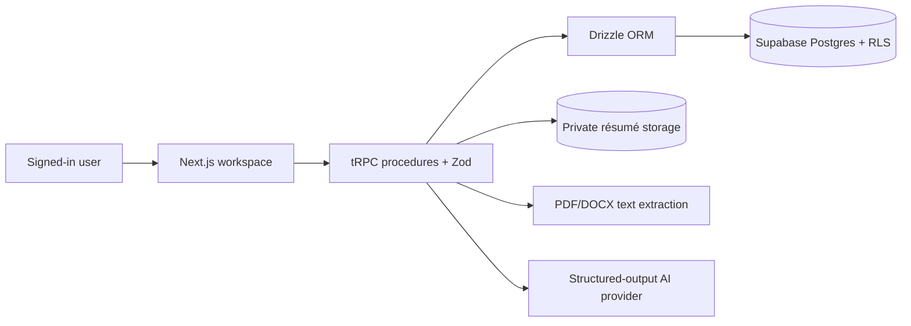

# SearchTrace — Lean Portfolio MVP PRD

**Status:** Scope-reduced MVP  
**Target delivery:** Two weeks; optional polish in weeks three to four  
**Product type:** Private, deployed web application  
**Primary user:** A job seeker applying for software roles  
**Working stack:** Next.js, TypeScript, tRPC, Drizzle ORM, Supabase Postgres/Auth/Storage, Tailwind CSS, Zod, one structured-output AI provider, Vercel

## 1. Executive Summary

### Problem Statement

Job seekers can collect job descriptions and revise a résumé, but they lack a clear, evidence-based view of which role requirements their actual materials support. Generic AI advice often hides the source material or overstates the strength of a match.

### Proposed Solution

SearchTrace analyzes **one job opportunity at a time**. A user uploads the résumé used for that opportunity, pastes its job description, optionally adds project evidence and employer feedback, then reviews an AI-generated, cited assessment of supported, weak, and missing requirements plus one practical next action.

The product promise is:

> See which requirements your submitted evidence supports, where it is weak, and one concrete thing to improve before the next application.

SearchTrace is an evidence-gap analyzer, not a job-search CRM, résumé writer, or hiring-outcome predictor.

### Success Criteria

- A new user can sign in, create an opportunity, upload a PDF or DOCX résumé, and request an analysis in under five minutes using a prepared test fixture.
- Every AI-generated requirement and coverage decision includes an excerpt from the supplied job description, résumé, project evidence, or opted-in feedback.
- The user can correct AI-drafted requirements and coverage states before saving the assessment.
- The product shows no ATS score, interview probability, or claim that an action will improve hiring outcomes.
- Authorization tests confirm that one signed-in user cannot access another user’s opportunities or private résumé files.
- A short recorded demo can show the complete flow in three minutes or less.

## 2. User Experience & Functionality

### User Persona

**Job-seeking software developer** — a student, graduate, or early-career engineer who has a résumé and projects but wants a more concrete way to tailor an application to a particular role.

### Primary Flow

1. The user signs in with email and password and reaches a private dashboard.
2. They create an opportunity with a company, role title, and pasted job description.
3. They upload one PDF or DOCX résumé for that opportunity. SearchTrace extracts the text and lets them review or edit it.
4. They optionally add short project/accomplishment evidence and employer feedback. Feedback is stored as either an exact quote or a personal summary.
5. After opting in to AI use of the reviewed résumé (and optionally feedback), the user requests an analysis.
6. SearchTrace drafts role requirements with job-description excerpts, then drafts a coverage state for each requirement using cited user evidence.
7. The user reviews, edits, accepts, or rejects the drafts. The saved result shows coverage counts and exactly one bounded next action.

### User Stories and Acceptance Criteria

#### Story 1 — Access a private workspace

As a job seeker, I want a private account so that my job-search information and résumé are not public.

**Acceptance criteria**

- The application supports email/password sign-up and sign-in with verified email addresses.
- Unauthenticated visitors see only the sign-in screen.
- Every application record has an owner, and database policies prevent access by other users.
- The MVP has no Google sign-in, invite allowlist, or user-facing administration screen.

#### Story 2 — Capture one opportunity

As a job seeker, I want to save a role and its job description so that I can analyze my materials against a specific application.

**Acceptance criteria**

- An opportunity requires a company, role title, and pasted job-description text.
- It may include an optional `https:` source URL and a user-selected status of `draft`, `applied`, `interviewing`, `rejected`, or `closed`.
- The dashboard lists the user’s opportunities with their status and most recent analysis state.
- There is no event timeline, funnel dashboard, derived stage logic, or cross-opportunity analytics.

#### Story 3 — Upload and review the résumé used for an opportunity

As a job seeker, I want to upload the résumé I used so that the assessment is based on the material I actually submitted.

**Acceptance criteria**

- One opportunity has at most one current résumé file: PDF or DOCX, up to 10 MB.
- The server validates file type, size, ownership, and storage path before saving it in a private bucket.
- The system extracts text server-side and displays it for review and editing before any AI request.
- Extraction has visible `pending`, `ready`, and `failed` states. A failure preserves the original file and offers retry.
- Files can be downloaded only through a short-lived, authenticated link.
- Replacing or deleting a résumé removes its prior private object after confirmation. Multi-version résumé libraries and résumé-to-outcome comparisons are deferred.

#### Story 4 — Add evidence and preserve employer feedback

As a job seeker, I want to add relevant project evidence and feedback so that the analysis has context beyond a résumé.

**Acceptance criteria**

- The user may add per-opportunity evidence with a title, short description, and optional `https:` link. Supported types are `project`, `accomplishment`, and `portfolio_link`.
- The user may add feedback with a date, text, source type (`recruiter_feedback`, `rejection_note`, `interview_feedback`, or `user_summary`), and a required label of `exact_quote` or `personal_summary`.
- The interface asks users not to include recruiter contact details, email headers, signatures, or attachments.
- Feedback is preserved as a reported signal. The product never presents it as proof of a rejection cause.
- Feedback is excluded from AI requests by default; the user can explicitly opt it in for that opportunity.
- Evidence and feedback can be edited or deleted. Deletion removes them from future analyses.

#### Story 5 — Review an explainable evidence-gap analysis

As a job seeker, I want to review and correct an assessment so that I can distinguish strong proof from assumptions and choose a sensible next step.

**Acceptance criteria**

- The user explicitly starts analysis only after the résumé text is ready and they acknowledge the provider data-use disclosure.
- The AI drafts 5–12 requirements in the categories `technical_skill`, `experience`, `education`, `responsibility`, or `other`; every requirement includes an exact job-description excerpt.
- The AI drafts one state per requirement: `supported`, `weak`, `missing`, or `unknown`. Each `supported` or `weak` result cites a résumé or user-entered-evidence excerpt; a `missing` result states what supplied evidence was not found.
- The user can edit, delete, or manually add requirements and can change every coverage state before saving.
- The results page shows counts by coverage state, the cited source excerpts, and exactly one proposed next action tied to a weak or missing requirement.
- The next action is phrased as a bounded improvement task, such as “add a deployed-project example that demonstrates API integration,” never as a promise of an interview or offer.
- The AI never changes the uploaded résumé, applies for a role, sends messages, or fetches the source URL.
- A model error, quota error, timeout, or invalid structured response leaves source records unchanged and offers a retry. No generic or invented substitute is shown.

### Non-Goals

This MVP will not include:

- Application timelines, funnel metrics, weekly diagnostics, experiments, or cross-opportunity comparisons.
- Multiple résumé versions per opportunity, résumé libraries, OCR, or formats beyond PDF/DOCX.
- AI résumé rewriting, cover-letter creation, ATS scores, hiring probabilities, or causal claims about employer feedback.
- Job-board scraping, URL fetching, email ingestion, browser extensions, GitHub OAuth, or automated applications.
- Google sign-in, invite allowlists, admin tooling, team workspaces, billing, exports, email reminders, or self-service account deletion.
- Public user data, a public demo account, or a marketing site.

## 3. AI System Requirements

### Responsibilities and Boundaries

The AI may extract draft requirements, assess user-supplied evidence, and suggest one next action. It may not invent work history, claim a requirement guarantees hiring success, determine causality from feedback, browse the web, use tools, or alter user records without review.

### Authorized Inputs

For a single opportunity, the request includes only:

- The stored job-description text.
- The user-reviewed résumé text after résumé-specific opt-in.
- The opportunity’s manually entered evidence.
- Feedback only when the user has opted that feedback into the request.

Before the first request, the user acknowledges that enabled content is sent to the configured AI provider. The UI identifies the included sources. The server does not log raw résumés, job descriptions, feedback text, prompts, or model output in operational logs.

### Output and Validation

- The provider returns structured JSON validated against a server-side Zod schema before it is shown or saved.
- The schema requires requirement text, category, job-description excerpt, coverage state, supporting source IDs/excerpts where applicable, one next action, and limitations.
- AI output begins as a reviewable draft. Only user-confirmed requirements and coverage results are saved.
- The product visibly separates user records and deterministic coverage counts from AI-generated interpretations.
- Initial protection against accidental spending is a server-side, configurable limit of five analysis requests per user per day.

### Evaluation for Portfolio Release

Use five anonymized or synthetic fixtures before deployment: clear match, partial match, no relevant evidence, feedback present, and malformed/oversized input. For each successful fixture, manually verify that every displayed citation points to the provided source and that the next action is tied to a weak or missing requirement.

## 4. Technical Specifications

### Architecture Overview

### Core Data Model

| Entity | Purpose |
|---|---|
| `profiles` | User identity and AI-disclosure acceptance metadata. |
| `opportunities` | Owner, company, role, job description, optional URL, status, and analysis timestamp. |
| `resumes` | One current résumé per opportunity: private path, file metadata, extracted/reviewed text, extraction state, and AI opt-in. |
| `evidence_items` | Opportunity-scoped project, accomplishment, or portfolio evidence. |
| `feedback_items` | Opportunity-scoped feedback with source type, quotation/summary provenance, and AI opt-in. |
| `requirements` | User-approved requirement, category, job-description excerpt, coverage state, and rationale/citations. |

No events, diagnostic history, experiments, requirement-evidence join table, résumé-version library, or audit-log entity is required for the MVP.

### Data Access and Migrations

- tRPC is the required application API layer. Protected procedures obtain the authenticated user from the Supabase-backed request context before invoking application services.
- Shared Zod schemas validate tRPC procedure inputs and structured AI outputs; inferred types flow to the client without a separately maintained REST contract.
- Drizzle ORM is the required server-side database access layer for Supabase Postgres.
- Drizzle schema definitions are the application’s canonical typed representation of tables, columns, relationships, indexes, and enums.
- Version-controlled Drizzle migrations create and evolve the application schema; production schema changes must not rely on undocumented dashboard edits.
- Database access remains server-only. Client components never receive database credentials or create direct Drizzle connections.
- Repository or query functions require the authenticated user ID and scope every read and mutation to that owner.
- Supabase continues to provide authentication, Postgres hosting, row-level security, and private résumé storage; Drizzle does not replace those services.

### Security and Privacy

- Supabase Auth protects workspace routes; every user-owned table has `user_id` and row-level security.
- Protected tRPC procedures verify the authenticated Supabase user before calling Drizzle. Every Drizzle query verifies ownership of the opportunity before accessing its résumé, evidence, feedback, or requirements.
- Cross-user tests cover both the public Supabase access boundary and protected tRPC procedures, including attempts to read, update, delete, or relate another user’s records.
- Database connection credentials remain server-only and are never exposed through browser bundles, logs, or error messages.
- Résumé objects use user-scoped private paths and authenticated, short-lived download URLs. Permanent public URLs are prohibited.
- All form inputs and AI responses are validated server-side. User content is rendered as plain text.
- The application stores only data needed for the flow and does not retain provider secrets or hidden model reasoning.

## 5. Delivery Plan and Risks

### Two-Week Build Plan

**Week 1 — Private vertical slice**

- Create the deployed Next.js application, email authentication, protected routes, tRPC context and protected-procedure middleware, Drizzle schema and migrations, and RLS/ownership tests.
- Build opportunity CRUD, private PDF/DOCX upload, extraction, and reviewed-text states.
- Build the basic opportunity detail interface and evidence/feedback forms.

**Week 2 — Explainable analysis and polish**

- Add the structured-output AI endpoint, disclosure, input selection, validation, and failure states.
- Build requirement review, coverage editing, citations, counts, and one next-action panel.
- Test with the five fixtures, verify mobile layout for review screens, and record a short portfolio demo.

### Optional Weeks 3–4

- Improve visual polish and loading/error states.
- Add a carefully scoped résumé version library or lightweight application history only if the core flow is fully tested and deployed.
- Create a larger anonymized AI evaluation set.

### Principal Risks and Mitigations

| Risk | Mitigation |
|---|---|
| PDF/DOCX extraction is unreliable | Require reviewable extracted text, show explicit failure states, and permit retry. |
| AI overstates support or fabricates claims | Require citations, preserve user review, label AI output as draft, and prohibit outcome claims in the prompt/schema. |
| Sensitive résumé or feedback content reaches the provider | Use explicit opt-in, identify included inputs, keep all sensitive toggles off by default, and avoid raw-content logs. |
| Scope grows back into a tracking platform | Treat the non-goals as release blockers; do not start weekly diagnostics, timelines, or multi-opportunity features before the demo is complete. |
| Unauthorized résumé access | Use RLS, private storage paths, signed downloads, and cross-user authorization tests. |

### Deferred Roadmap

After the portfolio release, validate whether users need application-event tracking before adding a simple timeline. Only after several opportunities exist should cross-opportunity patterns, weekly diagnostics, experiments, résumé comparisons, and richer evaluation be reconsidered.
