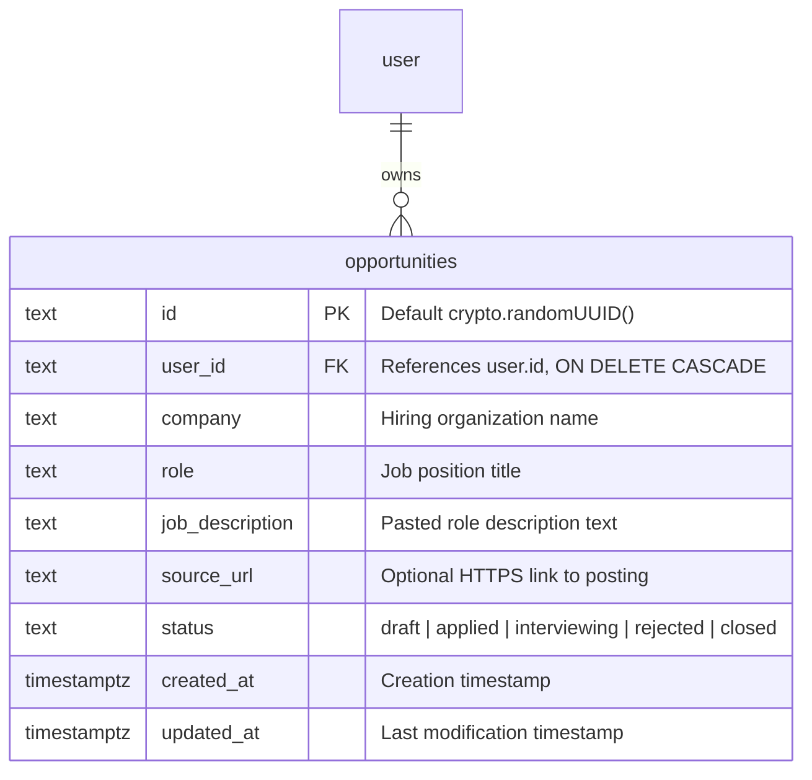
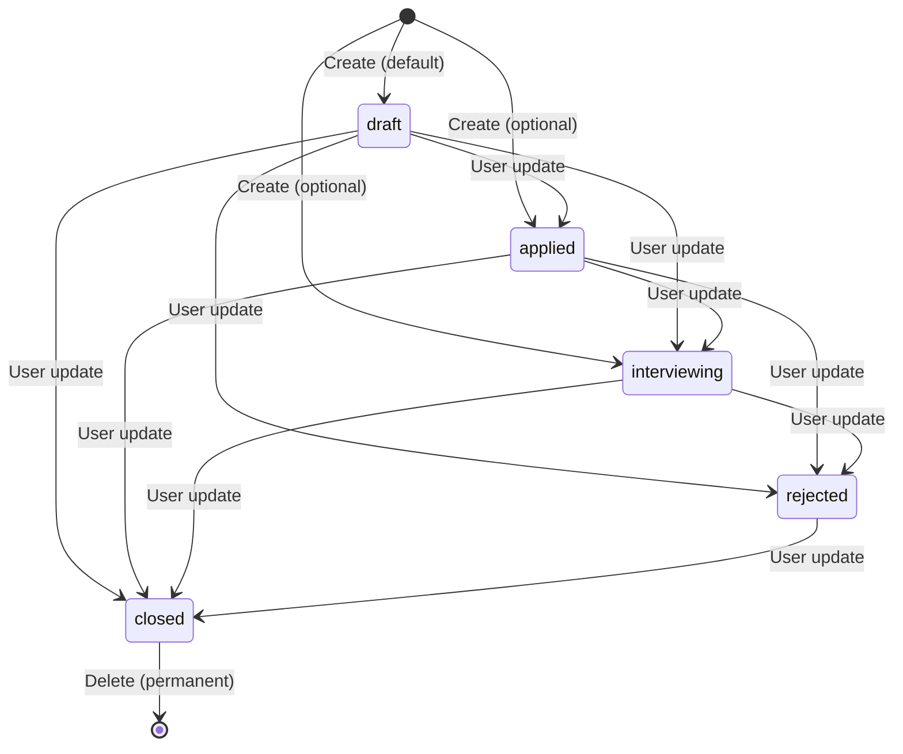

# Data Model: Opportunity Management

## Entities

### `Opportunity` (`opportunities` table)

Represents a single job opportunity targeted by a job seeker.

#### Field Specifications

| Column | Type | Constraints | Default | Description |
|---|---|---|---|---|
| `id` | `text` | PRIMARY KEY | `crypto.randomUUID()` | Unique record identifier |
| `user_id` | `text` | NOT NULL, REFERENCES `user(id)` ON DELETE CASCADE | — | Foreign key identifying the opportunity owner |
| `company` | `text` | NOT NULL | — | Name of the hiring organization |
| `role` | `text` | NOT NULL | — | Job title or role designation |
| `job_description` | `text` | NOT NULL | — | Verbatim pasted job description |
| `source_url` | `text` | NULLABLE | `NULL` | Optional link to external job posting (must be `https://`) |
| `status` | `text` | NOT NULL | `'draft'` | Progress state: `draft`, `applied`, `interviewing`, `rejected`, `closed` |
| `created_at` | `timestamptz` | NOT NULL | `now()` | Timestamp when created |
| `updated_at` | `timestamptz` | NOT NULL | `now()` | Timestamp when last updated |

#### Database Indexes

1. `opportunities_user_id_idx`: Index on `(user_id)` for rapid lookup of all opportunities owned by an authenticated user.
2. `opportunities_user_updated_idx`: Composite index on `(user_id, updated_at DESC)` to support chronological listing on the user's dashboard.

---

## Validation Rules & Invariants

| Attribute | Validation Rule | Error Message |
|---|---|---|
| `company` | String, trimmed, length between 1 and 100 characters. Reject whitespace-only. | `"Company name is required"` / `"Company name must be 100 characters or fewer"` |
| `role` | String, trimmed, length between 1 and 100 characters. Reject whitespace-only. | `"Role title is required"` / `"Role title must be 100 characters or fewer"` |
| `jobDescription` | String, trimmed, min length 1 character. Reject whitespace-only. | `"Job description is required"` |
| `sourceUrl` | Optional string; if provided, must parse as a valid URL beginning with `https://`. Reject other protocols. | `"Source URL must be a valid secure link (https://...)"` |
| `status` | Enum string: exactly one of `["draft", "applied", "interviewing", "rejected", "closed"]`. | `"Invalid opportunity status"` |

---

## State Transitions

Opportunities support five user-controlled statuses:

- **Transitions are user-driven**: In accordance with PRD non-goals, there is **no derived stage logic**, automated transition triggers, or funnel tracking. The user may change the status to any valid state at any time.
- **Deletion is terminal**: Deletion permanently removes the opportunity record and cascades to future child records.

---

## Ownership and Isolation Boundary

- **Owner-Scoped Queries**: Every database query on `opportunities` includes `eq(opportunities.userId, actorId)`.
- **Non-Enumeration Guarantee**: Attempting to read, update, or delete a record with an `id` that does not exist OR belongs to another user returns `unavailableResource()` (`TRPCError` with code `NOT_FOUND` and message `"The requested resource is unavailable."`).
