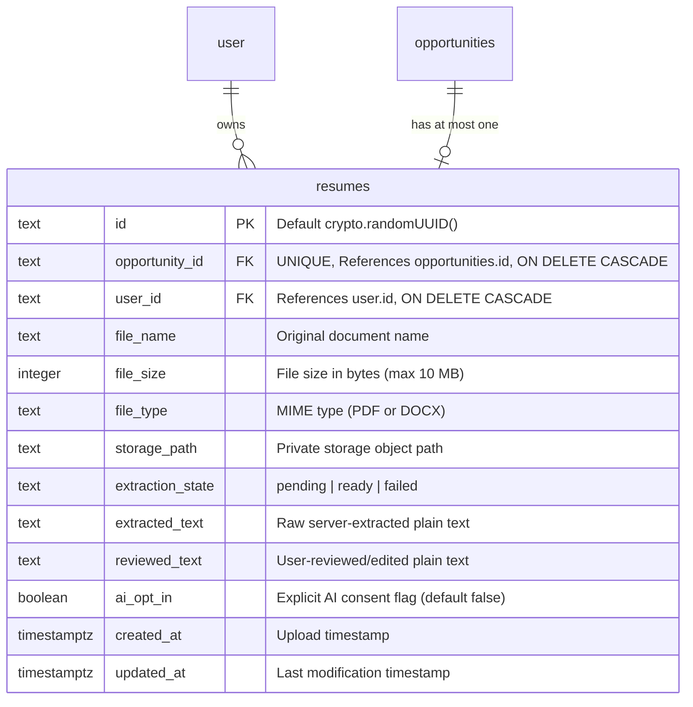
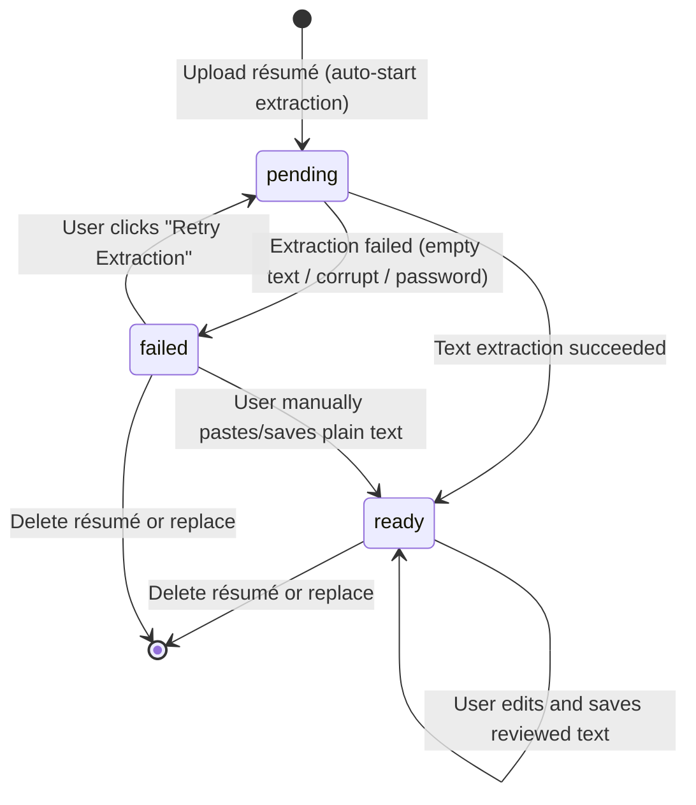

# Data Model: Private Résumé Upload and Review

## Entities

### `Resume` (`resumes` table)

Represents the single uploaded résumé document and its extracted/reviewed text attached to a specific job opportunity.

#### Field Specifications

| Column | Type | Constraints | Default | Description |
|---|---|---|---|---|
| `id` | `text` | PRIMARY KEY | `crypto.randomUUID()` | Unique record identifier |
| `opportunity_id` | `text` | NOT NULL, UNIQUE, REFERENCES `opportunities(id)` ON DELETE CASCADE | — | Foreign key enforcing at most one résumé per opportunity |
| `user_id` | `text` | NOT NULL, REFERENCES `user(id)` ON DELETE CASCADE | — | Foreign key identifying document owner |
| `file_name` | `text` | NOT NULL | — | Original name of uploaded document |
| `file_size` | `integer` | NOT NULL | — | Document size in bytes (max 10,485,760) |
| `file_type` | `text` | NOT NULL | — | MIME type: PDF or DOCX |
| `storage_path` | `text` | NOT NULL | — | Unguessable private path in object storage |
| `extraction_state` | `text` | NOT NULL | `'pending'` | Lifecycle state: `pending`, `ready`, `failed` |
| `extracted_text` | `text` | NULLABLE | `NULL` | Raw extracted plain text from parser |
| `reviewed_text` | `text` | NULLABLE | `NULL` | User-edited/reviewed plain text for gap analysis |
| `ai_opt_in` | `boolean` | NOT NULL | `false` | Explicit user consent for AI analysis inclusion |
| `created_at` | `timestamptz` | NOT NULL | `now()` | Upload timestamp |
| `updated_at` | `timestamptz` | NOT NULL | `now()` | Last modification timestamp |

#### Database Indexes

1. `resumes_opportunity_id_idx`: Unique index on `(opportunity_id)` guaranteeing single-résumé invariant per opportunity and fast opportunity-to-résumé lookups.
2. `resumes_user_id_idx`: Index on `(user_id)` for tenant isolation and ownership filtering.

---

## Validation Rules & Invariants

| Attribute | Validation Rule | Error Message / Handling |
|---|---|---|
| `file_size` | Integer $\le 10{,}485{,}760$ bytes (10 MB). | `"File size exceeds the 10 MB limit"` |
| `file_type` | Exactly `application/pdf` or `application/vnd.openxmlformats-officedocument.wordprocessingml.document`. | `"Only PDF and DOCX files are supported"` |
| `magic_bytes` | PDF: starts with `%PDF-` (`0x25 0x50 0x44 0x46 0x2D`). DOCX: starts with ZIP header `0x50 0x4B 0x03 0x04`. | `"File format does not match expected document signature"` |
| `extraction_state` | Enum string: exactly one of `["pending", "ready", "failed"]`. | `"Invalid extraction state"` |
| `reviewed_text` | Plain text, trimmed of outer whitespace. Nullable before initial extraction. | Plain text representation; zero HTML interpretation |
| `ai_opt_in` | Boolean (`true` or `false`). Defaults to `false`. | Must be boolean |

---

## State Transitions

The extraction lifecycle of a résumé transitions through three explicit states:

- **Upload / Replacement**: Creates or overwrites the record with `extraction_state = 'pending'` and resets `ai_opt_in = false`.
- **Extraction Complete**: When parser returns non-empty text, system sets `extracted_text`, copies it to `reviewed_text` as initial draft, and transitions to `ready`.
- **Extraction Failed**: If file is corrupt, encrypted, or image-only (scanned with 0 text characters), system marks `failed`. Uploaded file is retained in storage.
- **Manual Override**: A user in `failed` state can manually type or paste their text and click save; system sets `reviewed_text` and transitions state to `ready`.
- **Deletion**: Permanently removes the database row and deletes the private storage object.

---

## Ownership and Isolation Boundary

- **Owner-Scoped Verification**: Every résumé query or mutation verifies that the parent opportunity belongs to `ctx.actorId`.
- **Non-Enumeration Guarantee**: Any operation attempting to access a résumé or opportunity that does not exist or is owned by another user throws `unavailableResource()` (`TRPCError` with code `NOT_FOUND` and message `"The requested resource is unavailable."`).
- **Private Storage Isolation**: Files are stored in private paths under `resumes/${userId}/${opportunityId}/${uuid}-${sanitizedFileName}` with public access disabled. Downloads require server-generated signed URLs expiring in 60 seconds.
