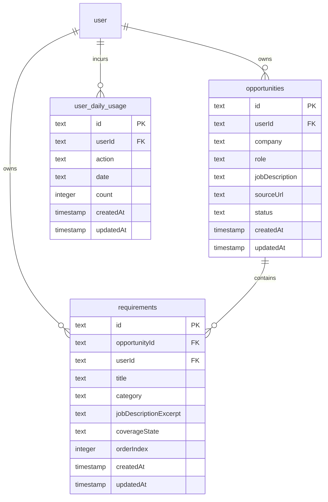
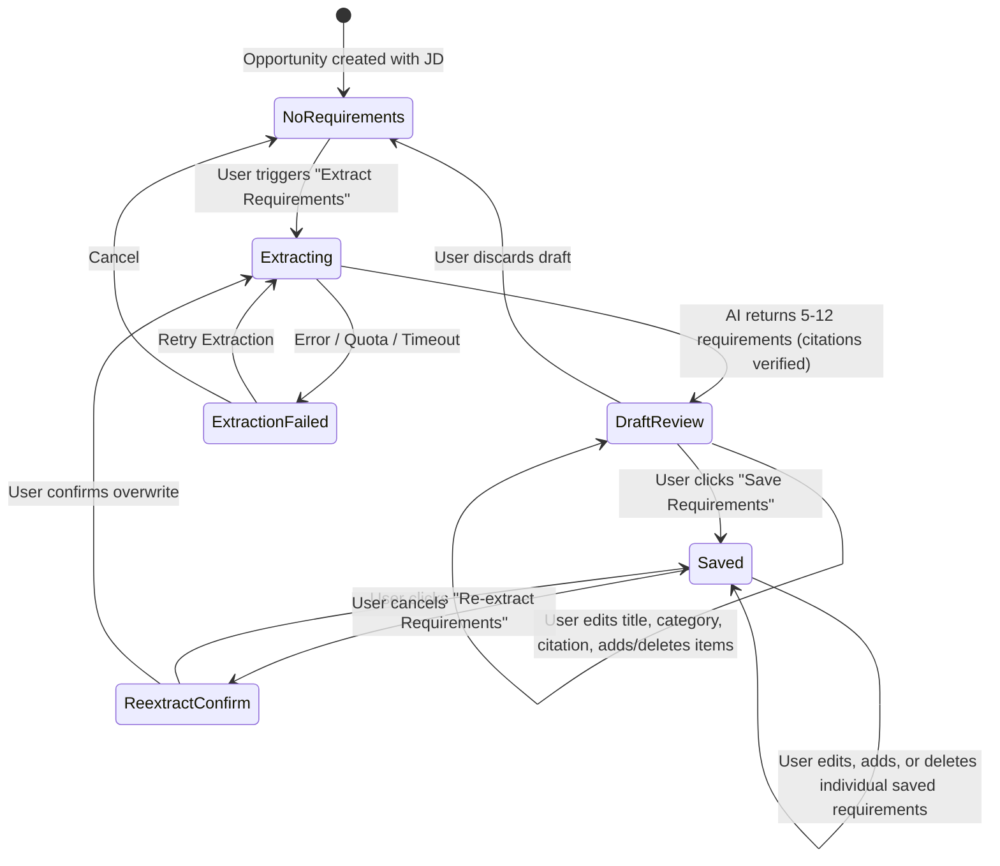

# Phase 1: Data Model & Schema Specifications

**Feature**: Requirement Extraction from Job Description  
**Branch**: `007-requirement-extraction`  
**Date**: 2026-09-08  
**Spec**: [spec.md](./spec.md)

---

## 1. Entity Relationship Diagram



---

## 2. Table Definitions (Drizzle ORM)

### 2.1 `requirements` Table

Persists user-confirmed role requirements associated with an opportunity.

| Column | Type | Nullable | Default | Description |
|---|---|:---:|:---:|---|
| `id` | `text` (UUID) | No | `crypto.randomUUID()` | Primary key |
| `opportunityId` | `text` | No | — | Foreign key $\to$ `opportunities.id` (`onDelete: "cascade"`) |
| `userId` | `text` | No | — | Foreign key $\to$ `user.id` (`onDelete: "cascade"`) |
| `title` | `text` | No | — | Short description of the requirement (e.g., "5+ years of React experience") |
| `category` | `text` | No | — | Enum: `technical_skill`, `experience`, `education`, `responsibility`, `other` |
| `jobDescriptionExcerpt` | `text` | No | — | Verbatim quotation cited from the opportunity's job description |
| `coverageState` | `text` | Yes | `NULL` | Future evidence-gap coverage state (`supported`, `weak`, `missing`, `unknown`) |
| `orderIndex` | `integer` | No | `0` | Deterministic ordering for display |
| `createdAt` | `timestamp with time zone` | No | `defaultNow()` | Creation timestamp |
| `updatedAt` | `timestamp with time zone` | No | `defaultNow()` | Last modification timestamp |

#### Indexes & Constraints
- `index("requirements_opportunity_id_idx").on(table.opportunityId)`: Efficient lookup of an opportunity's requirement list.
- `index("requirements_user_id_idx").on(table.userId)`: Owner-scoped filtering and cascading.
- `index("requirements_opp_order_idx").on(table.opportunityId, table.orderIndex)`: Sorted presentation queries.

---

### 2.2 `user_daily_usage` Table

Enforces the per-user analysis limit (default 5 extraction requests per day) authoritatively on the server.

| Column | Type | Nullable | Default | Description |
|---|---|:---:|:---:|---|
| `id` | `text` (UUID) | No | `crypto.randomUUID()` | Primary key |
| `userId` | `text` | No | — | Foreign key $\to$ `user.id` (`onDelete: "cascade"`) |
| `action` | `text` | No | — | Usage category (e.g., `'requirement_extraction'`) |
| `date` | `text` | No | — | UTC calendar date string (`YYYY-MM-DD`) |
| `count` | `integer` | No | `0` | Number of requests executed on this date |
| `createdAt` | `timestamp with time zone` | No | `defaultNow()` | Creation timestamp |
| `updatedAt` | `timestamp with time zone` | No | `defaultNow()` | Last increment timestamp |

#### Indexes & Constraints
- `uniqueIndex("user_daily_usage_user_action_date_idx").on(table.userId, table.action, table.date)`: Guarantees exactly one counter per user per action per calendar day.

---

## 3. Ephemeral / In-Memory Models

### 3.1 `RequirementDraft`

Represented in TypeScript / Zod schemas during client review prior to persistence.

```typescript
export interface RequirementDraft {
  tempId: string;                     // Temporary client-side UUID for keying
  title: string;                      // Requirement description
  category: RequirementCategory;      // 'technical_skill' | 'experience' | 'education' | 'responsibility' | 'other'
  jobDescriptionExcerpt: string;      // Verbatim quote from job description
  orderIndex: number;                 // Sequential ordering
}
```

---

## 4. State Transitions & Lifecycle



---

## 5. Validation Schemas (Zod)

```typescript
import { z } from "zod";

export const requirementCategoryEnum = z.enum([
  "technical_skill",
  "experience",
  "education",
  "responsibility",
  "other",
]);

export type RequirementCategory = z.infer<typeof requirementCategoryEnum>;

export const requirementItemSchema = z.object({
  title: z
    .string()
    .trim()
    .min(3, "Requirement title must be at least 3 characters")
    .max(300, "Requirement title must not exceed 300 characters"),
  category: requirementCategoryEnum,
  jobDescriptionExcerpt: z
    .string()
    .trim()
    .min(5, "Citation excerpt must be at least 5 characters")
    .max(1000, "Citation excerpt must not exceed 1000 characters"),
  orderIndex: z.number().int().min(0).default(0),
});

export const saveRequirementsInputSchema = z.object({
  opportunityId: z.string().uuid("Invalid opportunity identifier"),
  requirements: z
    .array(requirementItemSchema)
    .min(1, "At least one requirement must be provided")
    .max(30, "Cannot exceed 30 requirements per opportunity"),
});

export const extractRequirementsInputSchema = z.object({
  opportunityId: z.string().uuid("Invalid opportunity identifier"),
});

export const extractedRequirementResponseSchema = z.object({
  requirements: z.array(requirementItemSchema).min(5).max(12),
});
```
