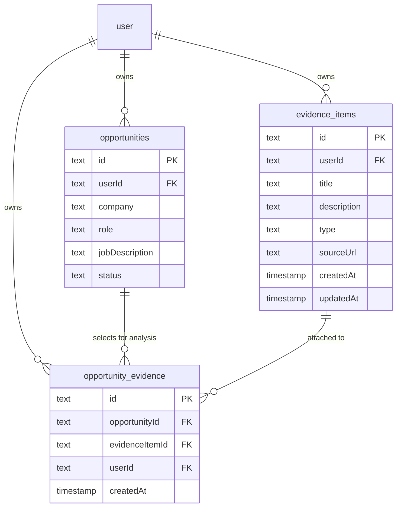
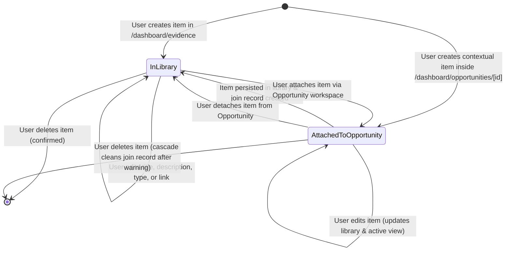

# Data Model: Supporting Evidence Library and Opportunity Selection

**Feature**: Supporting Evidence Library and Opportunity Selection  
**Branch**: `008-supporting-evidence`  
**Date**: 2026-09-08  
**Spec**: [spec.md](./spec.md)

---

## 1. Relational Entities & Schema Definitions

### 1.1 `evidence_items` Table

Represents a reusable, user-owned proof artifact in the personal evidence library.

```typescript
export const evidenceTypeEnum = z.enum(["project", "accomplishment", "portfolio_link"]);
export type EvidenceType = z.infer<typeof evidenceTypeEnum>;

export const evidenceItems = pgTable(
  "evidence_items",
  {
    id: text("id")
      .primaryKey()
      .$defaultFn(() => crypto.randomUUID()),
    userId: text("user_id")
      .notNull()
      .references(() => user.id, { onDelete: "cascade" }),
    title: text("title").notNull(),
    description: text("description").notNull(),
    type: text("type").$type<EvidenceType>().notNull(),
    sourceUrl: text("source_url"),
    createdAt: timestamp("created_at", { withTimezone: true })
      .notNull()
      .defaultNow(),
    updatedAt: timestamp("updated_at", { withTimezone: true })
      .notNull()
      .defaultNow(),
  },
  (table) => [
    index("evidence_items_user_id_idx").on(table.userId),
    index("evidence_items_user_updated_idx").on(table.userId, table.updatedAt),
  ],
);

export type EvidenceItem = typeof evidenceItems.$inferSelect;
export type NewEvidenceItem = typeof evidenceItems.$inferInsert;
```

#### Field Specifications

| Field | Type | Nullable | Constraints & Rules |
|---|---|:---:|---|
| `id` | `text` (UUID) | No | Primary key, default `crypto.randomUUID()`. |
| `userId` | `text` | No | Foreign key -> `user.id` (`ON DELETE CASCADE`). Enforces owner isolation. |
| `title` | `text` | No | Bounded string (1 to 120 characters, trimmed). |
| `description` | `text` | No | Bounded string (1 to 2,000 characters, trimmed). Plain-text rendering. |
| `type` | `text` (`EvidenceType`) | No | Strictly restricted to `'project'`, `'accomplishment'`, or `'portfolio_link'`. |
| `sourceUrl` | `text` | Yes | Optional HTTPS URL (max 500 characters, starting strictly with `https://`). |
| `createdAt` | `timestamp with tz` | No | Default `now()`. Immutable timestamp. |
| `updatedAt` | `timestamp with tz` | No | Default `now()`. Updated on edits. |

---

### 1.2 `opportunity_evidence` Table

Represents the many-to-many join relationship selecting a library evidence item for inclusion in a specific opportunity's analysis.

```typescript
export const opportunityEvidence = pgTable(
  "opportunity_evidence",
  {
    id: text("id")
      .primaryKey()
      .$defaultFn(() => crypto.randomUUID()),
    opportunityId: text("opportunity_id")
      .notNull()
      .references(() => opportunities.id, { onDelete: "cascade" }),
    evidenceItemId: text("evidence_item_id")
      .notNull()
      .references(() => evidenceItems.id, { onDelete: "cascade" }),
    userId: text("user_id")
      .notNull()
      .references(() => user.id, { onDelete: "cascade" }),
    createdAt: timestamp("created_at", { withTimezone: true })
      .notNull()
      .defaultNow(),
  },
  (table) => [
    uniqueIndex("opportunity_evidence_opp_evidence_idx").on(table.opportunityId, table.evidenceItemId),
    index("opportunity_evidence_opportunity_id_idx").on(table.opportunityId),
    index("opportunity_evidence_evidence_item_id_idx").on(table.evidenceItemId),
    index("opportunity_evidence_user_id_idx").on(table.userId),
  ],
);

export type OpportunityEvidence = typeof opportunityEvidence.$inferSelect;
export type NewOpportunityEvidence = typeof opportunityEvidence.$inferInsert;
```

#### Field Specifications

| Field | Type | Nullable | Constraints & Rules |
|---|---|:---:|---|
| `id` | `text` (UUID) | No | Primary key, default `crypto.randomUUID()`. |
| `opportunityId` | `text` | No | Foreign key -> `opportunities.id` (`ON DELETE CASCADE`). |
| `evidenceItemId` | `text` | No | Foreign key -> `evidence_items.id` (`ON DELETE CASCADE`). |
| `userId` | `text` | No | Foreign key -> `user.id` (`ON DELETE CASCADE`). Direct user ownership scoping. |
| `createdAt` | `timestamp with tz` | No | Default `now()`. Selection timestamp. |

#### Relational Constraints & Cascade Semantics
1. **Unique Association**: `(opportunityId, evidenceItemId)` is unique. Attempting to attach an already attached evidence item is a no-op or gracefully handled.
2. **Deleting an Opportunity**: Cascades to `opportunity_evidence` rows matching `opportunityId`. The underlying records in `evidence_items` remain intact in the user's library.
3. **Deleting an Evidence Item**: Cascades to `opportunity_evidence` rows matching `evidenceItemId`. The parent `opportunities` remain intact.
4. **Deleting a User**: Cascades to all `evidence_items` and `opportunity_evidence` records.

---

## 2. Validation Schemas (Zod)

Located in `lib/validations/evidence.ts`:

```typescript
import { z } from "zod";

export const evidenceTypeEnum = z.enum(["project", "accomplishment", "portfolio_link"]);
export type EvidenceType = z.infer<typeof evidenceTypeEnum>;

const httpsUrlSchema = z
  .string()
  .trim()
  .url("Source URL must be a valid URL")
  .refine((url) => url.startsWith("https://"), {
    message: "Source URL must use HTTPS",
  })
  .max(500, "URL must be 500 characters or fewer")
  .optional()
  .or(z.literal(""))
  .transform((val) => (val === "" || val === undefined ? undefined : val));

export const createEvidenceItemSchema = z.object({
  title: z
    .string()
    .trim()
    .min(1, "Title is required")
    .max(120, "Title must be 120 characters or fewer"),
  description: z
    .string()
    .trim()
    .min(1, "Description is required")
    .max(2000, "Description must be 2,000 characters or fewer"),
  type: evidenceTypeEnum,
  sourceUrl: httpsUrlSchema,
});
export type CreateEvidenceItemInput = z.infer<typeof createEvidenceItemSchema>;

export const updateEvidenceItemSchema = z.object({
  id: z.string().uuid("Invalid evidence item ID"),
  title: z
    .string()
    .trim()
    .min(1, "Title is required")
    .max(120, "Title must be 120 characters or fewer"),
  description: z
    .string()
    .trim()
    .min(1, "Description is required")
    .max(2000, "Description must be 2,000 characters or fewer"),
  type: evidenceTypeEnum,
  sourceUrl: httpsUrlSchema,
});
export type UpdateEvidenceItemInput = z.infer<typeof updateEvidenceItemSchema>;

export const attachEvidenceInputSchema = z.object({
  opportunityId: z.string().uuid("Invalid opportunity ID"),
  evidenceItemId: z.string().uuid("Invalid evidence item ID"),
});

export const detachEvidenceInputSchema = z.object({
  opportunityId: z.string().uuid("Invalid opportunity ID"),
  evidenceItemId: z.string().uuid("Invalid evidence item ID"),
});

export const createAndAttachEvidenceInputSchema = createEvidenceItemSchema.extend({
  opportunityId: z.string().uuid("Invalid opportunity ID"),
});
```

---

## 3. Entity Relationships Diagram



---

## 4. State & Lifecycle Transitions


