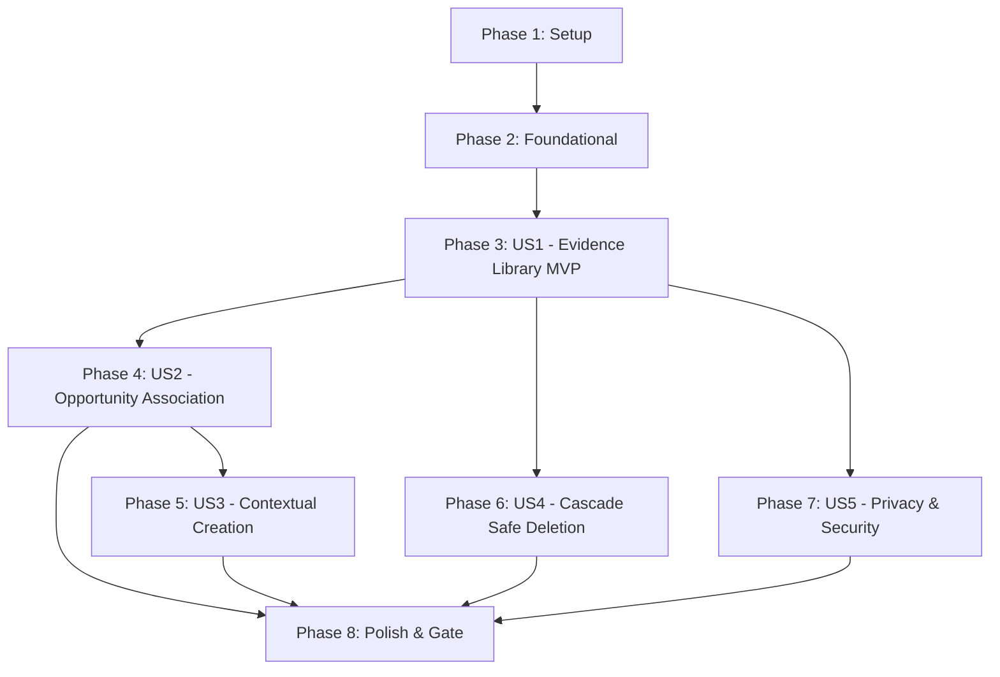

# Tasks: Supporting Evidence Library and Opportunity Selection

**Branch**: `008-supporting-evidence`  
**Input**: Design artifacts from `specs/008-supporting-evidence/` (`spec.md`, `plan.md`, `research.md`, `data-model.md`, `contracts/`, `quickstart.md`).

---

## Phase 1: Setup (Shared Infrastructure)

**Purpose**: Initialize directory structure, validation schemas, and shared types for supporting evidence.

- [X] T001 Create test, component, and page directories under `tests/008-supporting-evidence/` (`boundaries/`, `procedures/`, `components/`), `components/evidence/`, and `app/dashboard/evidence/`
- [X] T002 [P] Create shared Zod validation schemas for evidence items and association inputs in `lib/validations/evidence.ts`

---

## Phase 2: Foundational (Blocking Prerequisites)

**Purpose**: Database schema, Drizzle migration, and boundary isolation tests required before ANY user story can proceed.

**⚠️ CRITICAL**: Must be complete before implementing user story procedures and views.

- [X] T003 Add `evidence_items` and `opportunity_evidence` tables schema with indexes and cascading foreign keys in `lib/db/schema.ts`
- [X] T004 Generate Drizzle migration for the new evidence tables into `drizzle/` via `bun run db:generate -- --name add_evidence_tables`
- [X] T005 [P] Write static boundary tests asserting server-only database boundaries and isolation in `tests/008-supporting-evidence/boundaries/evidence-boundary.test.ts`

**Checkpoint**: Foundation ready — database schema, migration, validations, and boundary checks complete. User story implementation can now begin.

---

## Phase 3: User Story 1 - Maintain Personal Evidence Library (Priority: P1) 🎯 MVP

**Goal**: Authenticated job seekers can create, view, edit, and delete reusable proof items (`project`, `accomplishment`, `portfolio_link`) in their personal evidence library at `/dashboard/evidence` independently of any specific opportunity.

**Independent Test**: Navigate to `/dashboard/evidence`, create evidence items across all 3 types, edit an item's details, delete an unlinked item, and verify that changes persist accurately in the private library.

### Tests for User Story 1

- [X] T006 [P] [US1] Write procedure tests for `evidence.list`, `evidence.byId`, `evidence.create`, `evidence.update`, and `evidence.delete` in `tests/008-supporting-evidence/procedures/evidence-router.test.ts`
- [X] T007 [P] [US1] Write component tests for `EvidenceTypeBadge`, `EvidenceCard`, `EvidenceFormDialog`, and `EvidenceEmptyState` in `tests/008-supporting-evidence/components/evidence-views.test.tsx`

### Implementation for User Story 1

- [X] T008 [US1] Implement `evidence.list`, `evidence.byId`, `evidence.create`, `evidence.update`, and `evidence.delete` procedures in `trpc/routers/evidence.ts` and register `evidenceRouter` in `trpc/routers/_app.ts`
- [X] T009 [US1] Implement accessible `EvidenceTypeBadge` component in `components/evidence/evidence-type-badge.tsx`
- [X] T010 [US1] Implement accessible `EvidenceCard` component displaying title, category badge, plain-text description, external link, and edit/delete actions in `components/evidence/evidence-card.tsx`
- [X] T011 [US1] Implement accessible `EvidenceFormDialog` component for creating and editing library items with character counters and validation feedback in `components/evidence/evidence-form-dialog.tsx`
- [X] T012 [US1] Implement `EvidenceEmptyState` component with call-to-action in `components/evidence/evidence-empty-state.tsx`
- [X] T013 [US1] Implement personal evidence library page with category filter tabs in `app/dashboard/evidence/page.tsx`
- [X] T014 [US1] Enable "Evidence Library" navigation link in `components/app-shared.tsx`

**Checkpoint**: User Story 1 is fully functional: personal evidence library CRUD is operational and testable as a standalone MVP.

---

## Phase 4: User Story 2 - Select and Attach Evidence to an Opportunity (Priority: P1)

**Goal**: Authenticated users can view selected evidence for an opportunity, attach available library items, and detach items without modifying or deleting the underlying library records.

**Independent Test**: Open an opportunity detail page, verify the Supporting Evidence section distinguishes selected vs. available library items, attach 2 items, detach 1 item, and confirm that selections update immediately and independently of other opportunities.

### Tests for User Story 2

- [X] T015 [P] [US2] Write procedure tests for `evidence.listByOpportunityId`, `evidence.attach`, and `evidence.detach` in `tests/008-supporting-evidence/procedures/evidence-router.test.ts`
- [X] T016 [P] [US2] Write component tests for `OpportunityEvidenceSection` and `EvidencePickerDialog` in `tests/008-supporting-evidence/components/opportunity-evidence.test.tsx`

### Implementation for User Story 2

- [X] T017 [US2] Implement `evidence.listByOpportunityId`, `evidence.attach`, and `evidence.detach` procedures in `trpc/routers/evidence.ts`
- [X] T018 [US2] Implement accessible `EvidencePickerDialog` component to search, select, and attach unselected library items in `components/evidence/evidence-picker-dialog.tsx`
- [X] T019 [US2] Implement `OpportunityEvidenceSection` coordinator component displaying selected cards with detach controls and attach action in `components/evidence/opportunity-evidence-section.tsx`
- [X] T020 [US2] Embed `OpportunityEvidenceSection` into the opportunity detail view in `app/dashboard/opportunities/[opportunityId]/page.tsx`

**Checkpoint**: User Stories 1 and 2 work seamlessly together: users maintain evidence in their library and selectively attach it to opportunities.

---

## Phase 5: User Story 3 - Create Evidence Directly Within Opportunity Context (Priority: P2)

**Goal**: Authenticated users can add new proof directly from an opportunity view; the item is automatically saved to their library and immediately attached to the active opportunity.

**Independent Test**: On an opportunity detail page, click "New Evidence", fill in project details, save, and verify that the item appears in the opportunity's selected list and in `/dashboard/evidence`.

### Tests for User Story 3

- [X] T021 [P] [US3] Write procedure tests for `evidence.createAndAttach` in `tests/008-supporting-evidence/procedures/evidence-router.test.ts`
- [X] T022 [P] [US3] Write component tests for contextual creation workflow in `tests/008-supporting-evidence/components/opportunity-evidence.test.tsx`

### Implementation for User Story 3

- [X] T023 [US3] Implement `evidence.createAndAttach` procedure in `trpc/routers/evidence.ts`
- [X] T024 [US3] Integrate contextual creation action (`New Evidence` button opening `EvidenceFormDialog` in attach mode) into `components/evidence/opportunity-evidence-section.tsx`

**Checkpoint**: In-context evidence creation operates smoothly without navigating away from the opportunity review page.

---

## Phase 6: User Story 4 - Cascade Safe Deletion with Opportunity Warning (Priority: P2)

**Goal**: Warn users before deleting an evidence item that is attached to one or more opportunities, list the affected opportunities, and cleanly cascade removal across all associations upon confirmation.

**Independent Test**: Attach an evidence item to two distinct opportunities, initiate deletion from the library, confirm that the warning dialog lists both opportunities, confirm deletion, and verify that the item is cleanly removed from both opportunities and the library.

### Tests for User Story 4

- [X] T025 [P] [US4] Write procedure tests for `evidence.getAttachedOpportunities` and cascade deletion in `tests/008-supporting-evidence/procedures/evidence-router.test.ts`
- [X] T026 [P] [US4] Write component tests for `EvidenceDeleteDialog` warning behavior in `tests/008-supporting-evidence/components/evidence-views.test.tsx`

### Implementation for User Story 4

- [X] T027 [US4] Implement `evidence.getAttachedOpportunities` query procedure in `trpc/routers/evidence.ts`
- [X] T028 [US4] Implement accessible `EvidenceDeleteDialog` component displaying warning alert and attached opportunity list before confirmation in `components/evidence/evidence-delete-dialog.tsx`
- [X] T029 [US4] Integrate `EvidenceDeleteDialog` into `components/evidence/evidence-card.tsx` and `app/dashboard/evidence/page.tsx`

**Checkpoint**: Multi-opportunity cascade deletion protection is fully operational and prevents accidental loss of proof in active applications.

---

## Phase 7: User Story 5 - Enforce Owner Privacy and Safe Data Rendering (Priority: P1)

**Goal**: Prevent cross-user enumeration, verify dual-ownership on all associations, and ensure safe plain-text rendering with zero script injection risk.

**Independent Test**: Attempt cross-user reads, edits, deletes, and attachment combinations; verify that all attempts return generic 404 `unavailableResource()`; verify that script tags in titles or descriptions render as plain text.

### Tests for User Story 5

- [X] T030 [P] [US5] Write security & cross-user denial tests in `tests/008-supporting-evidence/procedures/evidence-router.test.ts` asserting 404 `unavailableResource()` on foreign reads, edits, deletes, and cross-user join attachments
- [X] T031 [P] [US5] Write plain-text rendering and XSS neutralization tests in `tests/008-supporting-evidence/components/evidence-views.test.tsx`

### Implementation for User Story 5

- [X] T032 [US5] Audit and assert zero raw user evidence logging across `trpc/routers/evidence.ts` and ensure all rendered text uses safe `whitespace-pre-wrap` styling

**Checkpoint**: Privacy, authorization, and plain-text presentation guarantees are validated and secure.

---

## Phase 8: Polish & Cross-Cutting Concerns

**Purpose**: Documentation updates, accessibility audits, quickstart validation, and quality gate execution.

- [X] T033 [P] Update `AGENTS.md` and repository documentation to reflect evidence library entities, procedures, and navigation
- [X] T034 Run accessibility audits (`jest-axe`) on all evidence views and modals in `tests/008-supporting-evidence/components/`
- [X] T035 Execute manual and automated validation scenarios from `specs/008-supporting-evidence/quickstart.md`
- [X] T036 Run complete quality gate (`bun run check`: lint, strict typecheck, and test suite)

---

## Dependencies & Execution Order

### Phase Dependencies



- **Phase 1 (Setup)**: Can start immediately.
- **Phase 2 (Foundational)**: Depends on Phase 1. Blocks all user stories.
- **Phase 3 (User Story 1 - MVP)**: Depends on Phase 2. Delivers standalone Evidence Library.
- **Phase 4 (User Story 2)**: Depends on Phase 3. Connects library to opportunities.
- **Phase 5 (User Story 3)**: Depends on Phase 4. Adds contextual creation inside opportunities.
- **Phase 6 (User Story 4)**: Depends on Phase 3. Adds deletion warning modal and cascade protection.
- **Phase 7 (User Story 5)**: Depends on Phase 3 and 4. Enforces security boundaries and plain text.
- **Phase 8 (Polish & Cross-Cutting)**: Depends on all user stories being complete.

---

## Parallel Execution Examples

### User Story 1
```powershell
# Run independent tests and components in parallel
Task: T006 "[P] [US1] Write procedure tests in tests/008-supporting-evidence/procedures/evidence-router.test.ts"
Task: T007 "[P] [US1] Write component tests in tests/008-supporting-evidence/components/evidence-views.test.tsx"
Task: T009 "[US1] Implement EvidenceTypeBadge in components/evidence/evidence-type-badge.tsx"
Task: T012 "[US1] Implement EvidenceEmptyState in components/evidence/evidence-empty-state.tsx"
```

### User Story 2
```powershell
# Run procedure tests and picker dialog in parallel
Task: T015 "[P] [US2] Write procedure tests in tests/008-supporting-evidence/procedures/evidence-router.test.ts"
Task: T016 "[P] [US2] Write component tests in tests/008-supporting-evidence/components/opportunity-evidence.test.tsx"
Task: T018 "[US2] Implement EvidencePickerDialog in components/evidence/evidence-picker-dialog.tsx"
```

---

## Implementation Strategy

### MVP First (User Story 1 Only)
1. Complete Phase 1: Setup (`lib/validations/evidence.ts`).
2. Complete Phase 2: Foundational (`schema.ts` + Drizzle migration `0004_add_evidence_tables.sql`).
3. Complete Phase 3: User Story 1 (personal library CRUD and `/dashboard/evidence` page).
4. **STOP and VALIDATE**: Verify personal evidence library works completely independently before proceeding to opportunity attachments.

### Incremental Delivery
1. Phase 1 + 2: Infrastructure and schema ready.
2. Phase 3: Personal Evidence Library functional (**MVP**).
3. Phase 4: Opportunity attachment and detachment active.
4. Phase 5: In-context creation streamlines application workflow.
5. Phase 6: Cascade warning dialog protects active applications.
6. Phase 7: Strict authorization and XSS sanitization verified.
7. Phase 8: Quality gate (`bun run check`) passes 100% offline.
