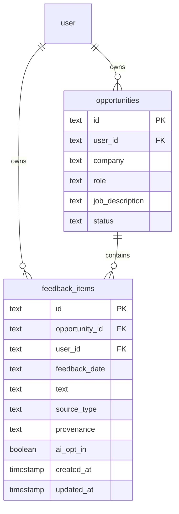
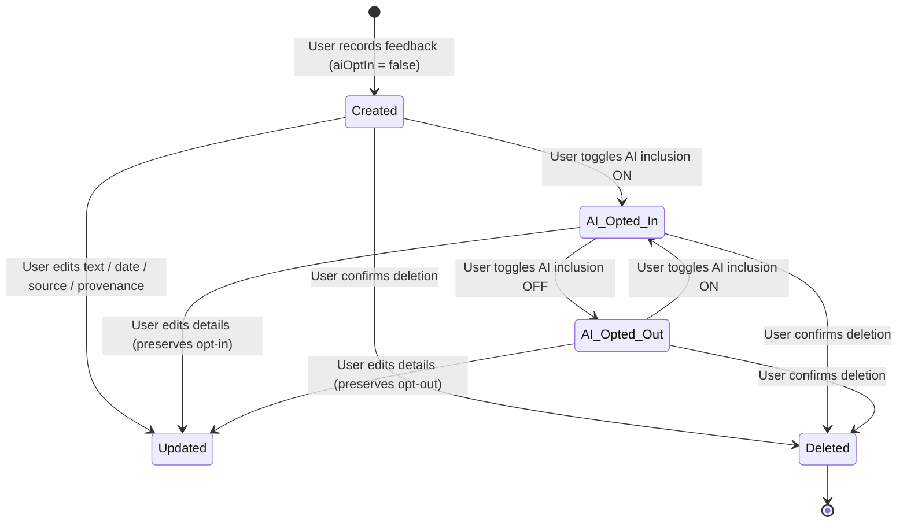

# Data Model: Opportunity Employer Feedback and Provenance Preservation

**Feature**: Opportunity Employer Feedback and Provenance Preservation  
**Branch**: `009-employer-feedback`  
**Date**: 2026-09-08  
**Spec**: [spec.md](./spec.md)

---

## 1. Relational Entities & Schema Definitions

### 1.1 `feedback_items` Table

Represents an opportunity-scoped, user-owned employer feedback record preserving source classification, quotation provenance, and AI opt-in status.

```typescript
import { boolean, index, pgTable, text, timestamp } from "drizzle-orm/pg-core";
import { user, opportunities } from "@/lib/db/schema";
import type { FeedbackSourceType, FeedbackProvenance } from "@/lib/validations/feedback";

export const feedbackItems = pgTable(
  "feedback_items",
  {
    id: text("id")
      .primaryKey()
      .$defaultFn(() => crypto.randomUUID()),
    opportunityId: text("opportunity_id")
      .notNull()
      .references(() => opportunities.id, { onDelete: "cascade" }),
    userId: text("user_id")
      .notNull()
      .references(() => user.id, { onDelete: "cascade" }),
    feedbackDate: text("feedback_date").notNull(),
    text: text("text").notNull(),
    sourceType: text("source_type").$type<FeedbackSourceType>().notNull(),
    provenance: text("provenance").$type<FeedbackProvenance>().notNull(),
    aiOptIn: boolean("ai_opt_in").notNull().default(false),
    createdAt: timestamp("created_at", { withTimezone: true })
      .notNull()
      .defaultNow(),
    updatedAt: timestamp("updated_at", { withTimezone: true })
      .notNull()
      .defaultNow(),
  },
  (table) => [
    index("feedback_items_opportunity_id_idx").on(table.opportunityId),
    index("feedback_items_user_id_idx").on(table.userId),
    index("feedback_items_opp_date_idx").on(table.opportunityId, table.feedbackDate),
  ],
);

export type FeedbackItem = typeof feedbackItems.$inferSelect;
export type NewFeedbackItem = typeof feedbackItems.$inferInsert;
```

#### Field Specifications

| Field | Column Type | Nullable | Default | Description & Validation Rules |
|---|---|:---:|---|---|
| `id` | `text` (UUID) | No | `crypto.randomUUID()` | Unique primary key identifier. |
| `opportunityId` | `text` | No | None | Foreign key -> `opportunities.id` (`ON DELETE CASCADE`). Scope boundary. |
| `userId` | `text` | No | None | Foreign key -> `user.id` (`ON DELETE CASCADE`). Owner boundary. |
| `feedbackDate` | `text` | No | None | Date string in ISO format (`YYYY-MM-DD`). |
| `text` | `text` | No | None | Feedback body (1 to 5,000 characters, trimmed). Rendered strictly as plain text. |
| `sourceType` | `text` | No | None | Restricted to: `'recruiter_feedback'`, `'rejection_note'`, `'interview_feedback'`, `'user_summary'`. |
| `provenance` | `text` | No | None | Restricted to: `'exact_quote'`, `'personal_summary'`. |
| `aiOptIn` | `boolean` | No | `false` | Explicit opt-in flag for inclusion in AI analysis requests. Default off. |
| `createdAt` | `timestamp with time zone` | No | `now()` | Record creation timestamp. |
| `updatedAt` | `timestamp with time zone` | No | `now()` | Last modification timestamp. |

---

## 2. Enums and Validation Types (`lib/validations/feedback.ts`)

```typescript
import { z } from "zod";

export const feedbackSourceTypeEnum = z.enum([
  "recruiter_feedback",
  "rejection_note",
  "interview_feedback",
  "user_summary",
]);

export type FeedbackSourceType = z.infer<typeof feedbackSourceTypeEnum>;

export const feedbackProvenanceEnum = z.enum([
  "exact_quote",
  "personal_summary",
]);

export type FeedbackProvenance = z.infer<typeof feedbackProvenanceEnum>;

export const feedbackDateSchema = z
  .string()
  .trim()
  .regex(/^\d{4}-\d{2}-\d{2}$/, "Date must be in YYYY-MM-DD format");

export const feedbackTextSchema = z
  .string()
  .trim()
  .min(1, "Feedback text is required")
  .max(5000, "Feedback text must be 5,000 characters or fewer");

export const createFeedbackItemSchema = z.object({
  opportunityId: z.string().trim().min(1, "Opportunity ID is required"),
  feedbackDate: feedbackDateSchema,
  text: feedbackTextSchema,
  sourceType: feedbackSourceTypeEnum,
  provenance: feedbackProvenanceEnum,
  aiOptIn: z.boolean().default(false),
});

export type CreateFeedbackItemInput = z.infer<typeof createFeedbackItemSchema>;

export const updateFeedbackItemSchema = z.object({
  id: z.string().trim().min(1, "Feedback item ID is required"),
  feedbackDate: feedbackDateSchema,
  text: feedbackTextSchema,
  sourceType: feedbackSourceTypeEnum,
  provenance: feedbackProvenanceEnum,
});

export type UpdateFeedbackItemInput = z.infer<typeof updateFeedbackItemSchema>;

export const setFeedbackAiOptInSchema = z.object({
  id: z.string().trim().min(1, "Feedback item ID is required"),
  aiOptIn: z.boolean(),
});

export type SetFeedbackAiOptInInput = z.infer<typeof setFeedbackAiOptInSchema>;

export const deleteFeedbackItemSchema = z.object({
  id: z.string().trim().min(1, "Feedback item ID is required"),
});

export type DeleteFeedbackItemInput = z.infer<typeof deleteFeedbackItemSchema>;

export const listFeedbackItemsSchema = z.object({
  opportunityId: z.string().trim().min(1, "Opportunity ID is required"),
});

export type ListFeedbackItemsInput = z.infer<typeof listFeedbackItemsSchema>;

export const getFeedbackItemByIdSchema = z.object({
  id: z.string().trim().min(1, "Feedback item ID is required"),
});

export type GetFeedbackItemByIdInput = z.infer<typeof getFeedbackItemByIdSchema>;
```

---

## 3. Entity Relationships



- **User -> Feedback Items**: 1-to-many. Cascades on user deletion (`onDelete: "cascade"`).
- **Opportunity -> Feedback Items**: 1-to-many. Cascades on opportunity deletion (`onDelete: "cascade"`).
- **Dual Ownership**: Every feedback mutation and query enforces that `userId` matches the authenticated actor (`ctx.actorId`) and verifies that the associated opportunity is also owned by `ctx.actorId`.

---

## 4. State Lifecycles

### 4.1 Feedback Item Lifecycle



---

## 5. Database Migrations

- **Migration File**: `drizzle/0005_add_feedback_items_table.sql`
- Generated via: `bun run db:generate -- --name add_feedback_items_table`
- Contains:
  - `CREATE TABLE IF NOT EXISTS "feedback_items" (...)`
  - Foreign key constraints with `ON DELETE CASCADE`
  - Indices for `opportunity_id`, `user_id`, and composite `(opportunity_id, feedback_date)`
