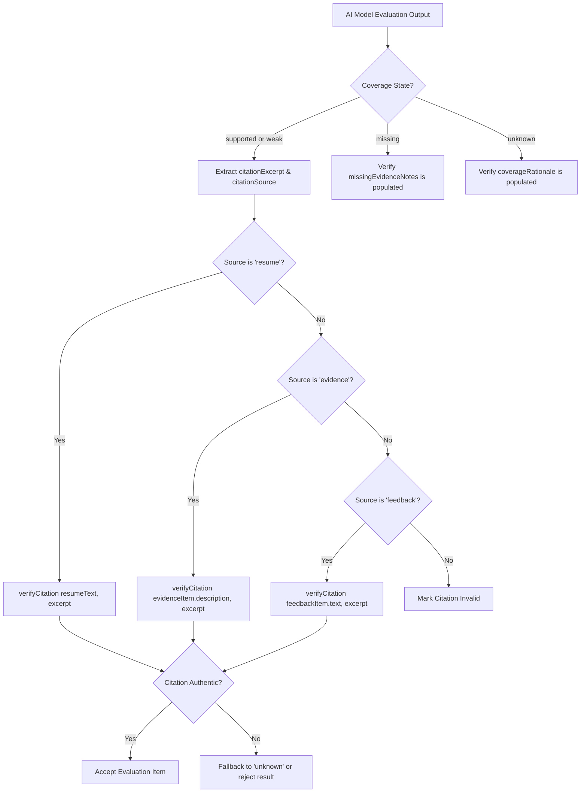

# AI Analyzer Contract: Vercel AI SDK & Gemini 3.6 Flash (`AiAnalyzerService`)

**Feature**: Opportunity Evidence-Gap Analysis  
**Branch**: `010-evidence-gap-analysis`  
**Date**: 2026-09-09  
**Spec**: [spec.md](../spec.md)

---

## 1. Overview

The `AiAnalyzerService` defines the server-side structured output contract powered by the **Vercel AI SDK** (`ai`, `@ai-sdk/google`) using **Google Gemini 3.6 Flash** (`gemini-3.6-flash`). It evaluates approved role requirements against candidate-supplied materials for a single opportunity and enforces verbatim citation verification before returning results.

---

## 2. Service Interface & Types

```typescript
// In lib/ai/types.ts
export interface AnalyzedRequirementEvaluation {
  requirementId: string;
  requirementTitle: string;
  category: RequirementCategory;
  jobDescriptionExcerpt: string;
  coverageState: CoverageState; // "supported" | "weak" | "missing" | "unknown"
  citationSource?: CitationSource; // "resume" | "evidence" | "feedback"
  citationExcerpt?: string;
  citationSourceTitle?: string;
  missingEvidenceNotes?: string;
  coverageRationale?: string;
}

export interface AnalyzedNextAction {
  text: string;
  targetRequirementId?: string;
  targetRequirementTitle?: string;
}

export interface EvidenceGapAnalysisResult {
  evaluations: AnalyzedRequirementEvaluation[];
  nextAction: AnalyzedNextAction;
  limitations: string;
}

export interface AnalyzeOpportunityEvidenceOptions {
  opportunityId: string;
  jobDescription: string;
  requirements: Array<{
    id: string;
    title: string;
    category: RequirementCategory;
    jobDescriptionExcerpt: string;
  }>;
  resumeText: string;
  evidenceItems: Array<{
    id: string;
    title: string;
    description: string;
    type: "project" | "accomplishment" | "portfolio_link";
    sourceUrl?: string | null;
  }>;
  feedbackItems: Array<{
    id: string;
    feedbackDate: string;
    text: string;
    sourceType: string;
    provenance: "exact_quote" | "personal_summary";
  }>;
}

export interface AiAnalyzerService {
  analyzeOpportunity(
    options: AnalyzeOpportunityEvidenceOptions
  ): Promise<EvidenceGapAnalysisResult>;
}
```

---

## 3. Gemini Prompt & Generation Architecture

### 3.1 Vercel AI SDK `generateObject()` Parameters

```typescript
const { object } = await generateObject({
  model: googleProvider("gemini-3.6-flash"),
  schema: aiAnalysisOutputSchema,
  temperature: 0.1,
  system: `You are an expert technical evidence-gap analyzer for software engineering roles.
Your task is to objectively evaluate approved role requirements against the candidate's supplied materials.

CORE EVALUATION PRINCIPLES:
1. EVIDENCE BEFORE INFERENCE: Every 'supported' or 'weak' coverage decision MUST cite an exact, authentic verbatim excerpt from the candidate's reviewed résumé, selected evidence, or opted-in feedback.
2. VERBATIM QUOTATIONS: Citation excerpts MUST be copied word-for-word without alteration, summarization, or synthesis.
3. CLEAR DETERMINATION RULES:
   - 'supported': Candidate materials contain clear, verifiable proof satisfying the requirement.
   - 'weak': Candidate materials contain relevant but partial, introductory, or indirect proof.
   - 'missing': Candidate materials were searched thoroughly and no relevant proof was found.
   - 'unknown': Candidate materials are ambiguous, contradictory, or insufficient to evaluate.
4. EVIDENCE CROSS-REFERENCING: Systematically evaluate attached evidence items alongside the résumé. If a requirement is absent or weakly demonstrated in the résumé, or if an attached project provides deeper, tangible proof, cite the attached evidence item with its specific title.
5. MISSING EVIDENCE NOTES: For every 'missing' requirement, explicitly state what specific evidence was sought across the submitted materials but not found.
6. BOUNDED NEXT ACTION: You MUST propose exactly ONE concrete, bounded improvement task (10–500 characters) tied to a weak or missing requirement (e.g., "Build a deployed project demonstrating TypeScript and PostgreSQL integration"). If all requirements are supported, propose an action to deepen practical demonstration of the highest-complexity requirement.
6. HONEST LIMITATIONS: Explicitly list the limitations and caveats of this evaluation (e.g. bounded solely by submitted text; not a guarantee of recruiter decisions or interview outcomes).
7. STRICT PROHIBITIONS:
   - NEVER calculate an ATS score, percentage match, or interview probability.
   - NEVER promise an offer or guarantee hiring success.
   - NEVER invent or synthesize evidence not present in the candidate's supplied text.`,
  prompt: `... structured prompt containing Job Description, Requirements, Résumé, Evidence Items, and Feedback ...`,
});
```

---

## 4. Citation Verification Pipeline

In accordance with Constitution Principle I (Evidence Before Inference), the server MUST deterministically verify that all citations for `supported` and `weak` evaluations are authentic substrings in the candidate's supplied materials.



### Verification Fallback Rules
- If an AI-suggested citation does not exist verbatim in the specified source text, the server flags the mismatch.
- To maintain honest uncertainty and prevent fabricated claims from surfacing, the server adjusts the requirement's state to `unknown` with a note stating that the cited quotation could not be verified in the submitted materials.

---

## 5. Offline Mock Implementation (`InMemoryAiAnalyzer`)

To ensure `bun run check` passes offline without API keys, `InMemoryAiAnalyzer` provides deterministic evaluation:
1. Matches requirement keywords (e.g., "TypeScript", "React", "SQL") against candidate résumé text and evidence descriptions.
2. Slices authentic verbatim sentences from the matching source text as citations for `supported` or `weak` states.
3. Marks requirements without keyword matches as `missing`, stating what qualification was searched for.
4. Selects the first `weak` or `missing` requirement and attaches a bounded next action targeting that requirement.
5. Produces standard assessment limitations.
