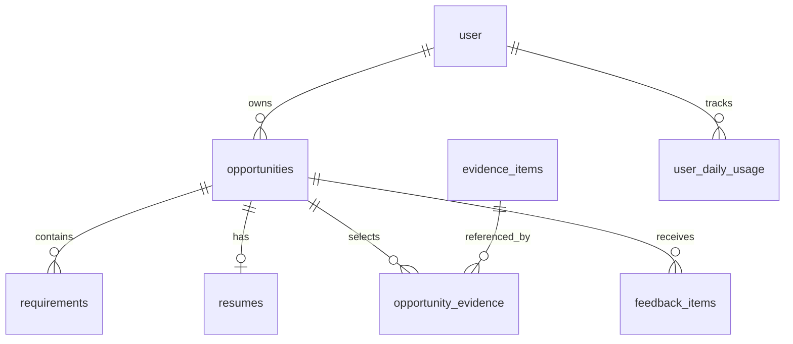
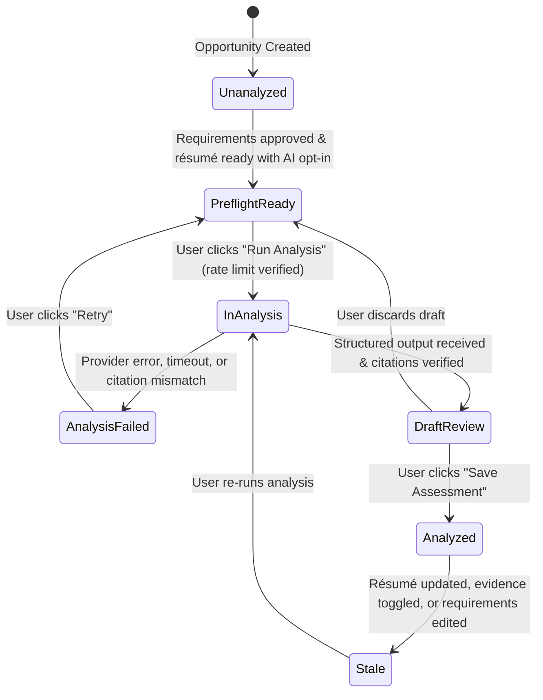

# Data Model: Opportunity Evidence-Gap Analysis

**Feature**: Opportunity Evidence-Gap Analysis  
**Branch**: `010-evidence-gap-analysis`  
**Date**: 2026-09-09  
**Spec**: [spec.md](./spec.md)

---

## 1. Entity Architecture & Schema Evolution

The Evidence-Gap Analysis feature leverages and evolves existing entities in `lib/db/schema.ts` without introducing unnecessary relational joins or event logs, strictly conforming to the PRD core data model and Constitution Principle V (Lean, Testable Delivery).



---

## 2. Relational Schema Changes (Drizzle ORM)

### 2.1 Enhancements to `requirements` Table

The `requirements` table represents approved role requirements. It is expanded to record verified coverage determinations, source-attributed verbatim citations, and missing evidence notes.

```typescript
export const coverageStateEnum = z.enum([
  "supported",
  "weak",
  "missing",
  "unknown",
]);

export type CoverageState = z.infer<typeof coverageStateEnum>;

export const citationSourceEnum = z.enum([
  "resume",
  "evidence",
  "feedback",
]);

export type CitationSource = z.infer<typeof citationSourceEnum>;

// In lib/db/schema.ts
export const requirements = pgTable(
  "requirements",
  {
    id: text("id").primaryKey().$defaultFn(() => crypto.randomUUID()),
    opportunityId: text("opportunity_id")
      .notNull()
      .references(() => opportunities.id, { onDelete: "cascade" }),
    userId: text("user_id")
      .notNull()
      .references(() => user.id, { onDelete: "cascade" }),
    title: text("title").notNull(),
    category: text("category").$type<RequirementCategory>().notNull(),
    jobDescriptionExcerpt: text("job_description_excerpt").notNull(),
    orderIndex: integer("order_index").notNull().default(0),

    // --- Evidence-Gap Analysis Columns ---
    coverageState: text("coverage_state").$type<CoverageState>(),
    citationSource: text("citation_source").$type<CitationSource>(),
    citationExcerpt: text("citation_excerpt"),
    citationSourceTitle: text("citation_source_title"),
    missingEvidenceNotes: text("missing_evidence_notes"),
    coverageRationale: text("coverage_rationale"),

    createdAt: timestamp("created_at", { withTimezone: true }).notNull().defaultNow(),
    updatedAt: timestamp("updated_at", { withTimezone: true }).notNull().defaultNow(),
  },
  (table) => [
    index("requirements_opportunity_id_idx").on(table.opportunityId),
    index("requirements_user_id_idx").on(table.userId),
    index("requirements_opp_order_idx").on(table.opportunityId, table.orderIndex),
    index("requirements_coverage_state_idx").on(table.opportunityId, table.coverageState),
  ]
);
```

#### Field Specifications: `requirements` Coverage Columns

| Field | Column Type | Nullable | Default | Description & Validation Rules |
|---|---|:---:|---|---|
| `coverageState` | `text` | Yes | `null` | Evaluated state: `'supported' \| 'weak' \| 'missing' \| 'unknown'`. Null until analysis is confirmed. |
| `citationSource` | `text` | Yes | `null` | Provenance source: `'resume' \| 'evidence' \| 'feedback'`. Required when state is `supported` or `weak`. |
| `citationExcerpt` | `text` | Yes | `null` | Exact verbatim quotation copied word-for-word from candidate's materials. Max 1,000 characters. |
| `citationSourceTitle` | `text` | Yes | `null` | Display label of the cited source (e.g. "Reviewed Résumé", "Portfolio Project: Real-time API"). Max 200 characters. |
| `missingEvidenceNotes` | `text` | Yes | `null` | Description of what specific evidence was searched for across submitted materials but not found. Max 1,000 characters. |
| `coverageRationale` | `text` | Yes | `null` | Brief evaluation summary explaining how the cited evidence (or lack thereof) supports the state. Max 1,000 characters. |

---

### 2.2 Enhancements to `opportunities` Table

The `opportunities` table is updated to record the analysis execution timestamp, the single bounded next action, its targeted requirement, and stated assessment limitations.

```typescript
// In lib/db/schema.ts
export const opportunities = pgTable(
  "opportunities",
  {
    id: text("id").primaryKey().$defaultFn(() => crypto.randomUUID()),
    userId: text("user_id")
      .notNull()
      .references(() => user.id, { onDelete: "cascade" }),
    company: text("company").notNull(),
    role: text("role").notNull(),
    jobDescription: text("job_description").notNull(),
    sourceUrl: text("source_url"),
    status: text("status").$type<OpportunityStatus>().notNull().default("draft"),

    // --- Evidence-Gap Analysis Columns ---
    lastAnalyzedAt: timestamp("last_analyzed_at", { withTimezone: true }),
    nextActionText: text("next_action_text"),
    nextActionRequirementId: text("next_action_requirement_id").references(
      () => requirements.id,
      { onDelete: "set null" }
    ),
    analysisLimitations: text("analysis_limitations"),

    createdAt: timestamp("created_at", { withTimezone: true }).notNull().defaultNow(),
    updatedAt: timestamp("updated_at", { withTimezone: true }).notNull().defaultNow(),
  },
  (table) => [
    index("opportunities_user_id_idx").on(table.userId),
    index("opportunities_user_updated_idx").on(table.userId, table.updatedAt),
    index("opportunities_analyzed_idx").on(table.userId, table.lastAnalyzedAt),
  ]
);
```

#### Field Specifications: `opportunities` Analysis Columns

| Field | Column Type | Nullable | Default | Description & Validation Rules |
|---|---|:---:|---|---|
| `lastAnalyzedAt` | `timestamp with time zone` | Yes | `null` | Timestamp when user confirmed and saved the most recent analysis. |
| `nextActionText` | `text` | Yes | `null` | Concrete, bounded improvement task (10–500 chars). Stored as plain text. |
| `nextActionRequirementId` | `text` (UUID) | Yes | `null` | Foreign key referencing the targeted weak or missing requirement. Set to null if requirement is deleted. |
| `analysisLimitations` | `text` | Yes | `null` | Stated limitations and caveats detailing evaluation boundaries (e.g., restricted to submitted text). Max 2,000 chars. |

---

## 3. Ephemeral In-Memory Entities (Client Review Draft)

In accordance with Constitution Principle II (Human Review and Control), AI analysis output begins as an uncommitted draft in client state before anything is persisted.

### 3.1 `EvidenceGapAnalysisDraft`

```typescript
export interface RequirementEvaluationDraft {
  requirementId: string;
  requirementTitle: string;
  category: RequirementCategory;
  jobDescriptionExcerpt: string;
  coverageState: CoverageState;
  citationSource?: CitationSource;
  citationExcerpt?: string;
  citationSourceTitle?: string;
  missingEvidenceNotes?: string;
  coverageRationale?: string;
}

export interface NextActionDraft {
  text: string;
  targetRequirementId?: string;
  targetRequirementTitle?: string;
}

export interface EvidenceGapAnalysisDraft {
  opportunityId: string;
  evaluations: RequirementEvaluationDraft[];
  nextAction: NextActionDraft;
  limitations: string;
  summaryCounts: {
    supported: number;
    weak: number;
    missing: number;
    unknown: number;
    total: number;
  };
}
```

---

## 4. Lifecycle & State Machine

### 4.1 Opportunity Analysis Lifecycle



### 4.2 State Invariants & Enforcement

1. **Pre-Flight Prerequisites**:
   - `requirements.length >= 1` (approved requirements must exist).
   - `resumes.extractionState === 'ready'` (plain text reviewable).
   - `resumes.aiOptIn === true` (explicit opt-in consent granted).
   - `userDailyUsage.count < 5` for action `"evidence_gap_analysis"` on the current UTC date.
2. **Citation Veracity Invariant**:
   - For every evaluation with `coverageState === 'supported' | 'weak'`:
     - `citationExcerpt` must not be empty.
     - `citationExcerpt` must exist verbatim in the authorized source (reviewed résumé text, selected evidence description, or opted-in feedback text).
3. **Bounded Next Action Invariant**:
   - Exactly one next action is generated.
   - If any requirements are in `weak` or `missing` state, the next action must reference a requirement that is `weak` or `missing`.
4. **Draft Immutability Invariant**:
   - Failure during analysis generation leaves existing `requirements` and `opportunities` rows completely untouched.
